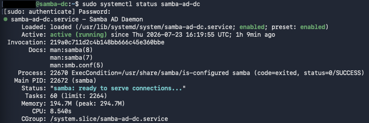
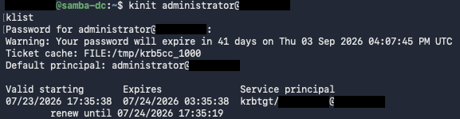
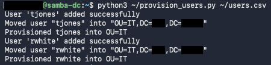
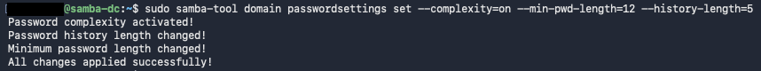
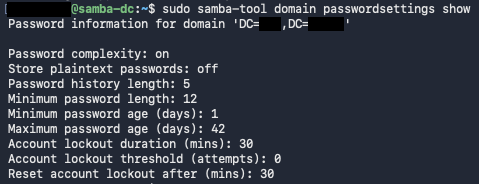
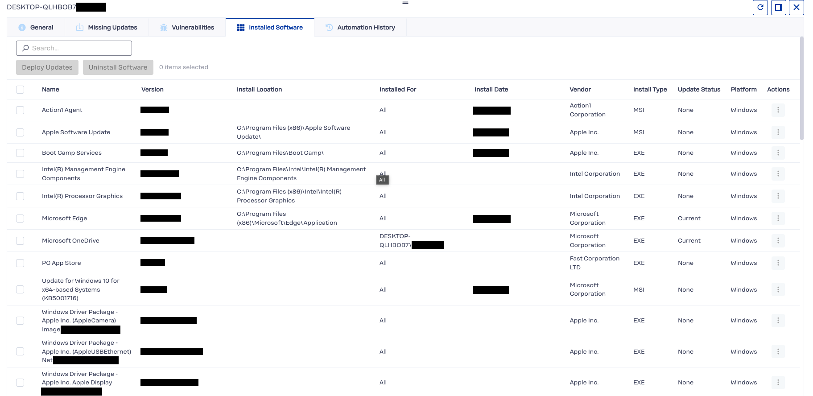
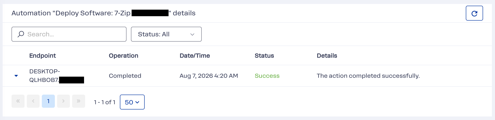
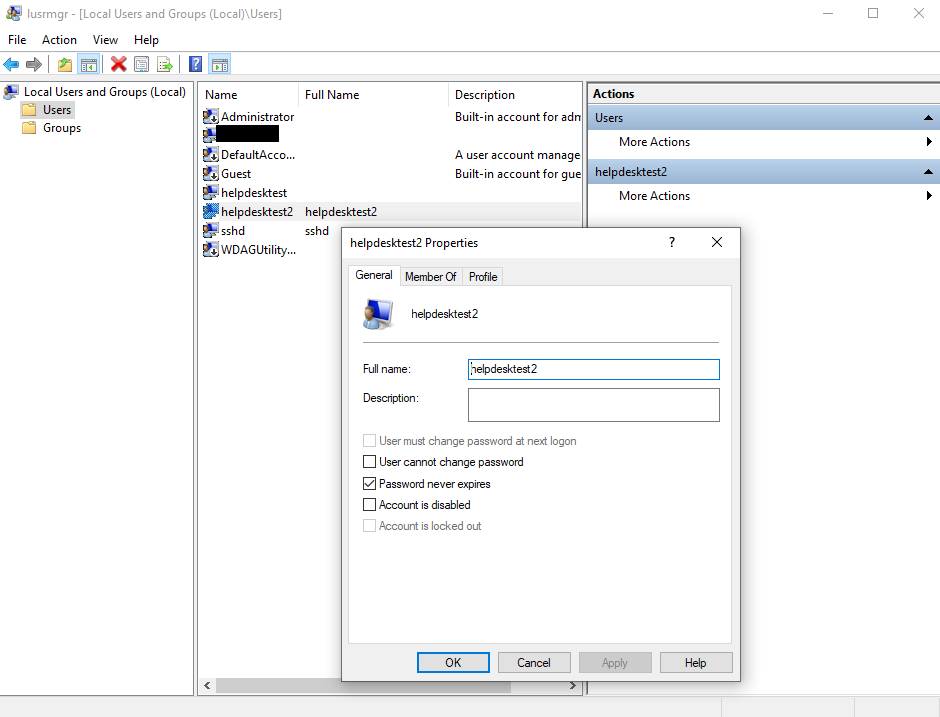
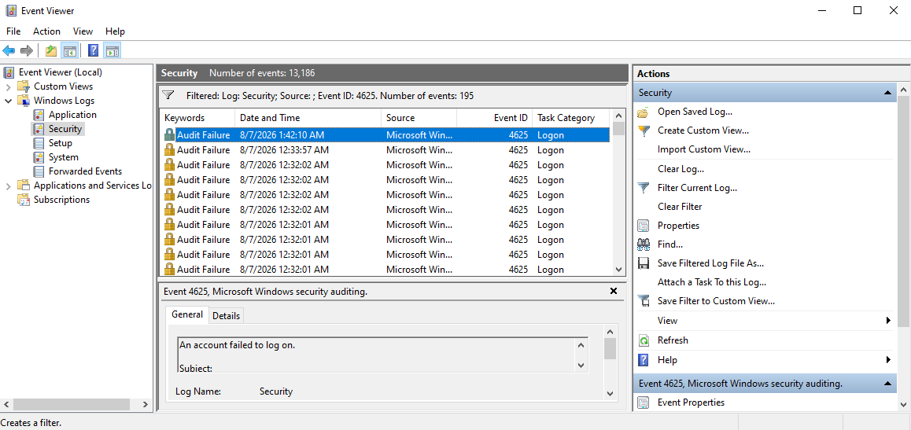
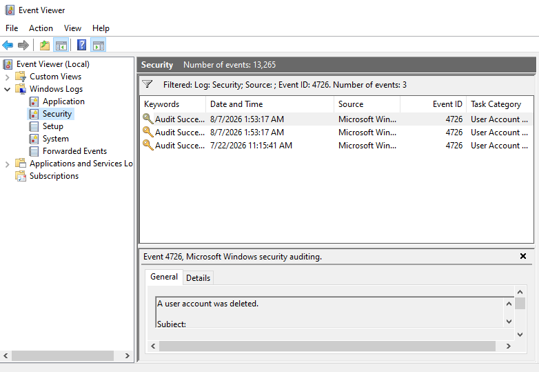

# IAM / Active Directory Case Study

## What this demonstrates

End-to-end Active Directory identity administration on a self-hosted Samba4 domain controller: domain provisioning, OU structure, bulk user creation, group-based delegation, and password and lockout policy. A physically separate Windows client (Windows 10 Pro) on the same network is joined as a real domain client. Identifying values are replaced or redacted.

## Environment

- **Domain controller (Samba DC):** Samba4 on its own Ubuntu Server VM, hosted on a MacBook Air running macOS; dual-homed, with one adapter on the home network and one on the isolated lab segment the other lab VMs use
- **SIEM:** Wazuh on a separate Ubuntu Server VM on the lab segment, built in [`siem-home-lab`](https://github.com/JSON-MSON/siem-home-lab)
- **Domain:** `EXAMPLE.TEST`
- **Domain client (Windows client):** Windows 10 Pro, bare-metal on a Mac mini, domain-joined (`Get-CimInstance Win32_ComputerSystem` returns `PartOfDomain: True` and `Domain: example.test`)

## Key findings

Five findings, each backed by evidence in the sections below.

**A permission read back from the wrong object is not verification.** The Helpdesk-IT delegation was written as a Reset Password entry on the IT OU and read back from the OU, which confirmed only that the entry exists there. A later check (October 2, 2026) read the three user objects first provisioned into the OU: none of them carries the entry. It was written without an inheritance flag, so it governs the OU object itself and is not passed down to the accounts in it, which is where the Reset Password right applies. As configured, it gives Helpdesk-IT's members no Reset Password right on those users. The read-back showed what the command did to the object it touched, not the access the delegation was meant to grant.

**A command reporting success and a setting being active are two different claims.** The domain password policy was read back from the directory after being set, and the lockout was read from the locked account itself; only the read-back is evidence. The delegation finding adds a condition: the read-back has to come from the object the setting governs.

**Two unrelated control planes caught the same attack independently.** A directory-service lockout policy and a log-based SIEM rule both fired on one live brute-force run, and neither depends on the other. That is defense in depth in substance, not just in name.

**A backup is not proven until a restore is compared against a known prior state.** The restored domain's user list matches a snapshot taken before the simulated failure, and the snapshot is committed so the comparison can be re-run at any time. The built-in `samba-tool domain backup` tooling also proved the less reliable path here, and establishing that through research, rather than working around it blind, mattered more than following the original plan.

**Not every capability gap is worth closing.** Extending SIEM monitoring to the Windows client was considered and rejected, because it would have required routing between an attack-simulation segment and the real network. The decision is documented below.

## Risk response: a decision not to extend SIEM monitoring to the Windows client

### The decision

Extending the Wazuh SIEM to the domain-joined Windows client, to centralize its Security Event Log as Ubuntu Server's authentication log already is, was considered once both machines were in the same domain. It was not done: the Wazuh manager runs on Ubuntu Server on the isolated lab segment used for attack simulation, while the Windows client sat on the home network. Connecting them would open a route between an intentionally hostile segment and every other device on the home network. That trade was rejected: a gap in log centralization was accepted rather than exchanged for a materially worse one.

### Why this counts as a risk response, not just infrastructure

Everywhere else in this portfolio's hands-on labs, the work is technical: a rule is written, a policy configured, a system provisioned. Here no tool was built and no rule written. A risk was identified, weighed against the benefit it would have unlocked, and the lab's segmentation boundary was chosen over a feature. NIST CSF 2.0 names this outcome under Identify: "Risk responses are chosen, prioritized, planned, tracked, and communicated" (ID.RA-06). Stating that tradeoff plainly, in writing, is itself the deliverable.

### What this doesn't claim

This isn't a claim to have built an organizational risk-governance program; a single-operator home lab doesn't have one. It is one real decision for one system, documented plainly. It came before the portfolio's formal governance work, `governance-risk-lab`, a NIST RMF assessment of this same lab whose system security plan records it as an earlier owner decision.

## Process

Each step shows the commands that built the domain, consolidated from the Samba DC's shell history; failed attempts and retries are left out. Step 1 turned up two behaviors worth knowing; the rest is straightforward.

### 1. Provision the domain and bring up the DC role

```bash
sudo apt install -y samba krb5-config winbind smbclient samba-ad-provision samba-dsdb-modules samba-vfs-modules acl krb5-user
sudo mv /etc/samba/smb.conf /etc/samba/smb.conf.orig
sudo samba-tool domain provision --use-rfc2307 --interactive
```

Provisioning creates the AD databases and adds the initial records, including the domain administrator account and the required DNS entries ([Samba wiki](https://wiki.samba.org/index.php/Setting_up_Samba_as_an_Active_Directory_Domain_Controller)). Realm `EXAMPLE.TEST`, domain `EXAMPLE`, role `dc`, DNS backend `SAMBA_INTERNAL`.

**Ubuntu's base `samba` package does not provide the Active Directory domain controller role.** Its package description covers a stand-alone file and print server and points to the separate `samba-ad-dc` package for an AD DC. With that package installed, the file-server services were stopped and disabled, and the AD DC service unmasked and enabled:

```bash
sudo apt install -y samba-ad-dc
sudo systemctl stop smbd nmbd winbind
sudo systemctl disable smbd nmbd winbind
sudo systemctl unmask samba-ad-dc
sudo systemctl enable --now samba-ad-dc
```

**Samba's internal DNS has to answer on port 53**, so `systemd-resolved` was disabled and the machine set to resolve against itself:

```bash
sudo systemctl disable --now systemd-resolved
sudo rm /etc/resolv.conf
echo "nameserver 127.0.0.1" | sudo tee /etc/resolv.conf
echo "search example.test" | sudo tee -a /etc/resolv.conf
sudo systemctl restart samba-ad-dc
```



### 2. Confirm the domain is functional

`kinit administrator@EXAMPLE.TEST` followed by `klist` issues and lists a valid Kerberos ticket.



### 3. Build the OU structure and provision users

```bash
sudo samba-tool ou create "OU=IT,DC=example,DC=test"

for u in jsmith agarcia mchen; do
  sudo samba-tool user create "$u" "<temp-password>" --given-name="$u"
  sudo samba-tool user move "$u" "OU=IT,DC=example,DC=test"
done
```

### 4. Delegate password-reset rights on the IT OU

```bash
sudo samba-tool group add Helpdesk-IT
sudo samba-tool group addmembers Helpdesk-IT jsmith
sudo samba-tool user setexpiry jsmith --days=0
```

Delegation is a direct access control entry on the OU, using AD's "Reset Password" extended-right GUID (which Microsoft defines as permitting "resetting a password on a user account"), granted to the Helpdesk-IT group's SID:

```bash
sudo samba-tool dsacl set --objectdn="OU=IT,DC=example,DC=test" \
  --sddl="(OA;;CR;00299570-246d-11d0-a768-00aa006e0529;;S-1-5-21-1000000001-1000000002-1000000003-1106)"
```

The entry's second field, its inheritance flags, is empty, so the entry is not passed down to the user objects in the OU; Microsoft's ACE documentation names `CONTAINER_INHERIT_ACE` and `OBJECT_INHERIT_ACE` as the flags that make child objects inherit an entry. The read-back from the OU confirms only that the entry exists there:

```bash
sudo samba-tool dsacl get --objectdn="OU=IT,DC=example,DC=test" | grep -o "(OA;[^)]*1106)"
```


Checked again on October 2, 2026 against the users themselves: `samba-tool dsacl get` on `jsmith`, `agarcia`, and `mchen` shows no Reset Password entry for Helpdesk-IT ([`delegation_user_check_2026-10-02.txt`](delegation_user_check_2026-10-02.txt)). Fixing it would mean writing the entry with inheritance to user objects, then confirming the right on a user, not on the OU. The fix was not made: the entry is kept as it stands, and the access control policy in `governance-risk-lab` records that Helpdesk-IT holds no right over any user account.

## Files in this repo

- `user_list.txt` — output of `samba-tool user list`, showing the three provisioned users alongside built-in accounts
- `helpdesk_members.txt` — confirms jsmith's membership in Helpdesk-IT
- `delegation_ace.txt` — the raw access control entry as written on the IT OU
- `users.csv` — input data for scripted bulk provisioning (see addendum below)
- `provision_users.py` — the CSV-driven provisioning script
- `pre_failure_state.txt` — the domain's user list recorded before the simulated failure
- `delegation_user_check_2026-10-02.txt` — the Reset Password entry checked on the IT OU and on the three users first provisioned into it
- `setexpiry_evidence.txt` — the `--days=0` expiry, the expired-account error, and the fix
- `lockout_policy_readback.txt` — the domain's password and lockout settings, read back on October 2, 2026
- `lockout_evidence_2026-08-04.txt` — Ubuntu Server's journal: five failed domain logons, then the lockout answers
- `siem_alerts_rule100010_2026-08-04.json` — every rule 100010 alert of August 4, from the Wazuh manager's alert log
- `ipv6_kdc_crash_evidence.txt` — the recurring KDC bind failure, the live `disable_ipv6` value, and both netplan files
- `backup_restore_journal_2026-08-05.txt` — the Samba DC's journal for the backup and restore attempts
- `action1_endpoint_evidence.txt` — the client's log records of the agent install and the 7-Zip install and removal
- `security_log_4625_4726_readback.txt` — the client's failed logons and account deletions, in UTC
- `screenshots/` — terminal and console captures, placed inline next to the step each one documents

## What I'd do differently in production

- Verify a delegated right where it applies — on the user objects, or by exercising it — not only on the container that holds the entry.
- Use Group Policy to enforce least-privilege settings at the client level, not just in the directory: through Samba, whose Group Policy support needs configuration beyond provisioning (per the Samba wiki), or through a Windows Server DC.

---

## Addendum: CSV-Driven Provisioning and Domain Password Policy

### What this adds

The original build hardcoded three usernames in a shell loop. This addendum replaces that with data-driven provisioning from a CSV file, reusing Python skills from the [`log-ioc-parser`](https://github.com/JSON-MSON/log-ioc-parser) project, and adds a verified domain-wide password policy.

### The provisioning script

```python
#!/usr/bin/env python3
import csv
import os
import subprocess
import sys

TEMP_PASSWORD = os.environ["TEMP_PASSWORD"]

with open(sys.argv[1]) as f:
    reader = csv.DictReader(f)
    for row in reader:
        subprocess.run([
            "sudo", "samba-tool", "user", "create",
            row["username"], TEMP_PASSWORD,
            f"--given-name={row['given_name']}"
        ], check=True)
        subprocess.run([
            "sudo", "samba-tool", "user", "move",
            row["username"], row["ou"]
        ], check=True)
        print(f"Provisioned {row['username']} into {row['ou']}")
```

The temporary password comes from an environment variable, so the script can be published without a working credential. `csv.DictReader` keys each row by the CSV's header row, so `row["username"]` works regardless of column order. `subprocess.run([...], check=True)` passes the command as a list of arguments rather than one concatenated string, so no shell parses it, which avoids the injection risk of string-built commands. `check=True` stops the script on any failed `samba-tool` call instead of continuing past a broken step.

One flaw shows in the output below: the `ou` field in `users.csv` is unquoted, so `csv.DictReader` splits `OU=IT,DC=example,DC=test` at its commas and `row["ou"]` holds only `OU=IT`, hence "Provisioned tjones into OU=IT". The users still landed in the right OU because `samba-tool user move` appends the domain DN to a parent DN that lacks it. Quoting the field in the CSV fixes the parsing.



### The domain password policy

```bash
sudo samba-tool domain passwordsettings set --complexity=on --min-pwd-length=12 --history-length=5
```



Verified independently, not just trusted from the `set` command's own success message:

```bash
sudo samba-tool domain passwordsettings show
```

Confirmed active: complexity on, 12-character minimum, 5-password history. The screenshot predates the lockout policy: its lockout threshold still reads 0 (no lockout), which is set to 5 in the addendum below.



## Addendum: Layered Defense — AD Account Lockout and SIEM Correlation

### What this adds

This domain's account lockout policy and the Wazuh SIEM from this portfolio's SIEM project respond to the same attack independently: two control layers, neither aware of nor dependent on the other, rather than a single point of detection dressed up as two.

### Prerequisite: joining Ubuntu Server (SIEM) to the domain

Testing this required a real SSH domain login against Ubuntu Server, which had not been joined to the domain; only the Windows client (see Environment above) had. Ubuntu Server was joined first (winbind, NSS, PAM), entirely within the isolated lab segment that the Samba DC's second interface already shares, so the lab's network isolation boundary did not change.

That process surfaced a real, previously undetected bug: the original build (Step 4 above) ran `samba-tool user setexpiry jsmith --days=0`, intending "never expires", but `--days=0` sets the expiry to the moment the command runs, so the account expired immediately. `jsmith`'s account had been silently expired since its creation on July 23, unnoticed because nothing before this had attempted a real password-based domain login ([`setexpiry_evidence.txt`](setexpiry_evidence.txt)). Fixed with the correct flag:

```bash
sudo samba-tool user setexpiry jsmith --noexpiry
```

### Steps

```bash
# Domain-wide account lockout policy (Samba4)
sudo samba-tool domain passwordsettings set --account-lockout-threshold=5 --account-lockout-duration=15 --reset-account-lockout-after=15

# Attack (Kali Linux, targeting the now domain-integrated Ubuntu Server)
hydra -t 4 -l jsmith -P /usr/share/wordlists/rockyou.txt ssh://198.51.100.130
```

The lockout settings, read back from the domain on October 2, 2026, are in [`lockout_policy_readback.txt`](lockout_policy_readback.txt).

### Layer 1: directory service response

```
$ sudo samba-tool user show jsmith | grep -i lock
lockoutTime: 134303420349577910
```

A non-zero value confirms the domain locked the account after 5 failed attempts. The value is an AD timestamp (100-nanosecond intervals since January 1, 1601) that decodes to **2026-08-04 18:33:54.957 UTC**, 0.6 seconds before the first SIEM alert from the attacking host below. That gives the two layers an independently verifiable point of correlation rather than two separate assertions that they fired. Ubuntu Server's journal shows the same sequence from its side: five `NT_STATUS_LOGON_FAILURE` answers, the fifth at 18:33:54.956801, then `NT_STATUS_ACCOUNT_LOCKED_OUT` ([`lockout_evidence_2026-08-04.txt`](lockout_evidence_2026-08-04.txt)).

### Layer 2: SIEM response

Wazuh's rule 100010 (built in this portfolio's SIEM project; T1110, ATT&CK v19.2) fired independently, 23 times against the attacking host across a 38-second window, reading `auth.log`/`journald` on Ubuntu Server directly with no dependency on the AD lockout state. A twenty-fourth alert that day came from the MacBook Air's address 26 minutes before the attack began and is excluded from this count. All 24 alerts are in [`siem_alerts_rule100010_2026-08-04.json`](siem_alerts_rule100010_2026-08-04.json); the fragment below is shortened from one of them.

```json
{"rule":{"id":"100010","description":"Multiple SSH authentication failures from same source - possible brute force (T1110)","mitre":{"id":["T1110"]}},"data":{"srcip":"198.51.100.128","dstuser":"jsmith"}}
```

## Addendum: Backup and Disaster Recovery Verification

### What this adds

Backup *verification*, not just creation: a backup is proven only by a restore. This addendum simulates a failure and proves recovery with a diff, not just a service that comes back up.

### A recurring IPv6 KDC crash

Before backup testing could start, Samba4 hit an IPv6-related KDC crash (`kdc_add_socket: Failed to bind to 2001:db8::4 UDP`) that had recurred despite an earlier fix. The cause this time: the earlier fix was a `disable_ipv6` setting written to `/etc/sysctl.conf` but not in effect (read on October 2, the live value is still `0`), while netplan still enabled DHCPv6 on both interfaces and accepted IPv6 Router Advertisements (`accept-ra`) on one, either of which can assign a global IPv6 address ([`ipv6_kdc_crash_evidence.txt`](ipv6_kdc_crash_evidence.txt)). Disabling both in netplan is what made the fix durable. Both interfaces were set to `accept-ra: false` and `dhcp6: false` in `/etc/netplan/00-installer-config.yaml` (the original kept as `.orig`). The resulting file:

```yaml
# This is the network config written by 'subiquity'
network:
  ethernets:
    enp26s0:
      accept-ra: false
      dhcp4: true
      dhcp6: false
    enp2s0:
      accept-ra: false
      dhcp4: true
      dhcp6: false
      match:
        macaddress: 00:00:5e:00:53:01
      set-name: enp2s0
  version: 2
```

Then applied:

```bash
sudo netplan apply
```

### Why `samba-tool domain backup online`/`restore` was abandoned

The built-in Samba backup and restore workflow was tried first, per the original plan, and hit three separate issues in sequence:

- a CLDAP self-discovery failure during backup, which turned out to be the DC service itself being down from the IPv6 crash above (once that was fixed, the backup ran against the Samba DC's own address);
- an upstream-acknowledged Samba limitation that prevents a restore from reusing the DC name already in the backup ([samba mailing list, February 2019](https://lists.samba.org/archive/samba/2019-February/221019.html): the restore adds the new DC to the database before removing the old entries, so a DC with the same name cannot be added because it already exists);
- an unresolved internal `"Samba failed to prime database, error code 22"` failure, with no public documentation matching this scenario.

The Samba DC's journal records each attempt and failure ([`backup_restore_journal_2026-08-05.txt`](backup_restore_journal_2026-08-05.txt)). Rather than keep chasing an obscure, apparently fragile code path, the approach switched to a simpler, well-established method: a plain file-level backup of the AD database directory.

### Steps

```bash
# Record pre-failure state
sudo samba-tool user list > ~/pre_failure_state.txt

# Backup: stop briefly for a consistent copy, archive, restart
sudo systemctl stop samba-ad-dc
sudo tar -czvf ~/samba-private-backup.tar.gz -C /var/lib/samba private
sudo systemctl start samba-ad-dc

# Simulate failure — rename the live database out of the way, not delete
sudo systemctl stop samba-ad-dc
sudo mv /var/lib/samba/private /var/lib/samba/private.simulated-failure-2

# Restore from the archive
sudo mkdir /var/lib/samba/private
sudo tar -xzvf ~/samba-private-backup.tar.gz -C /var/lib/samba
sudo systemctl start samba-ad-dc
```

### Verification

```bash
diff <(sudo samba-tool user list | sort) <(sort ~/pre_failure_state.txt)
```

Empty output: the restored domain's user list is identical to the pre-failure snapshot (`tjones`, `mchen`, `Guest`, `krbtgt`, `Administrator`, `jsmith`, `rwhite`, `agarcia`). The snapshot file is committed to this repo, so the comparison can be re-run against the live domain at any time.

## Addendum: RMM, Local Windows IAM, and Security Log Review

### What this adds

Action1 RMM enrollment and endpoint management, local Windows identity administration through both the command line and the GUI, and security log review, extending this project's identity work from the directory to the domain-joined Windows client itself.

### Action1 RMM: enrollment, inventory, and a scripted deployment

At the time, the Windows client was kept offline by default (no internet access), so this needed the same brief, deliberate connection window used elsewhere in this lab. The Action1 agent installs silently over PowerShell, like any other Windows agent:

```powershell
Invoke-WebRequest -Uri "<org-specific-agent-url>" -OutFile $env:tmp\action1-agent.msi
msiexec.exe /i $env:tmp\action1-agent.msi /qn
```

Enrollment was confirmed both locally (`Get-Service` shows the internal service name, `A1Agent`, running; "Action1 Agent" is the display name) and in the console (endpoint listed as `Connected`, with hardware and OS detail).

Two actions demonstrate two RMM competencies, visibility and deployment:

- **Software inventory** — Action1 contacts the endpoint when a query runs, so the data is live rather than collected hours or days earlier ([Action1 documentation](https://www.action1.com/documentation/data-collected-by-action1-agent/)). The screenshot shows installed-software data (Boot Camp Services, Apple Software Update, Intel drivers) pulled from this machine.



- **Scripted deployment** — 7-Zip pushed remotely through the console's Deploy Software action. The first attempt failed with `"The endpoint has not completed the automation within 1 minute(s)."`, not an install failure but an automation completion deadline set too short; Action1 documents that an automation "will be terminated if it exceeds this deadline." With a longer deadline the deployment succeeded (the run in the screenshot below), and 7-Zip appeared in the software inventory with version and vendor data. It was then uninstalled through the same console to leave the endpoint as it was. The endpoint's Application log records the install at 08:20:12 UTC and the removal at 08:25:14 UTC on August 7 ([`action1_endpoint_evidence.txt`](action1_endpoint_evidence.txt), which also holds the agent's own install records).



### Local Windows IAM through both interfaces

The same provisioning task, done once through each interface:

```powershell
New-LocalUser -Name "helpdesktest" -NoPassword
Add-LocalGroupMember -Group "Users" -Member "helpdesktest"
```

A second account, `helpdesktest2`, was created through `lusrmgr.msc` (Local Users and Groups) at the physical console: the graphical console has no SSH equivalent, and this lab has no second Windows machine from which to use Computer Management's [remote connection](https://learn.microsoft.com/en-us/archive/technet-wiki/4558.computer-management). Both accounts were confirmed side by side in the same user list.



### Security events in Event Viewer

A deliberately wrong password was entered at the console, and the resulting entry located in Windows Logs → Security:

- **Event ID 4625** ("An account failed to log on"): the entry at the top of the filtered list, 1:42:10 AM. Read back from the log afterward, it is the only failed interactive (console) logon that night. The filter matched 195 failed logons up to and including that console test: most of the rest are a burst of failed network logons under other account names shortly after midnight, the cluster below the test entry. The log, read back in UTC (the client displayed local time at UTC−7), is in [`security_log_4625_4726_readback.txt`](security_log_4625_4726_readback.txt).



- **Event ID 4726** ("A user account was deleted"), captured when both test accounts were removed as cleanup: two entries at 1:53:17 AM, one per deleted account, confirmed by reading the log back. The third entry, from July 22, is an earlier deletion.



### A networking finding: disconnecting the Windows client

The Windows client was designed at the time to have no internet access, so it was disconnected again after this work; that became troubleshooting in its own right. With DHCP disabled and DNS pointed at `0.0.0.0`, `Test-NetConnection 8.8.8.8` still succeeded, because a default route through the home gateway remained. The explanation at the time was a **persistent route**, stored in the registry's persistent-route store and left over from an earlier `route -p`: a default `Get-NetRoute` listing showed the route only in the active store, and the persistent entry appeared only in the classic `route print` output under Persistent Routes. The classic command cleared it in that session:

```powershell
route delete 0.0.0.0 mask 0.0.0.0 192.0.2.254
```

([`Remove-NetRoute`](https://learn.microsoft.com/en-us/powershell/module/nettcpip/remove-netroute) with its `-PolicyStore` parameter reaches the same store from PowerShell.) Afterward `route print` listed no persistent routes, and `Test-NetConnection 8.8.8.8` returned `PingSucceeded: False`, with no route and no source address.

The fix did not last. It was checked only within that session, and by September 17 the machine had a default gateway route again, by a mechanism that was not identified. On September 29 the no-internet design was abandoned, leaving the client's internet access in place until its retirement, recorded in `governance-risk-lab`.
